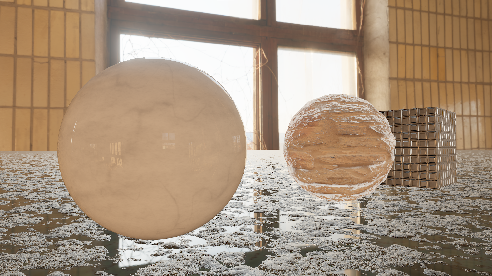
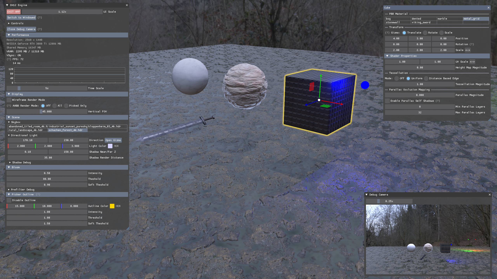
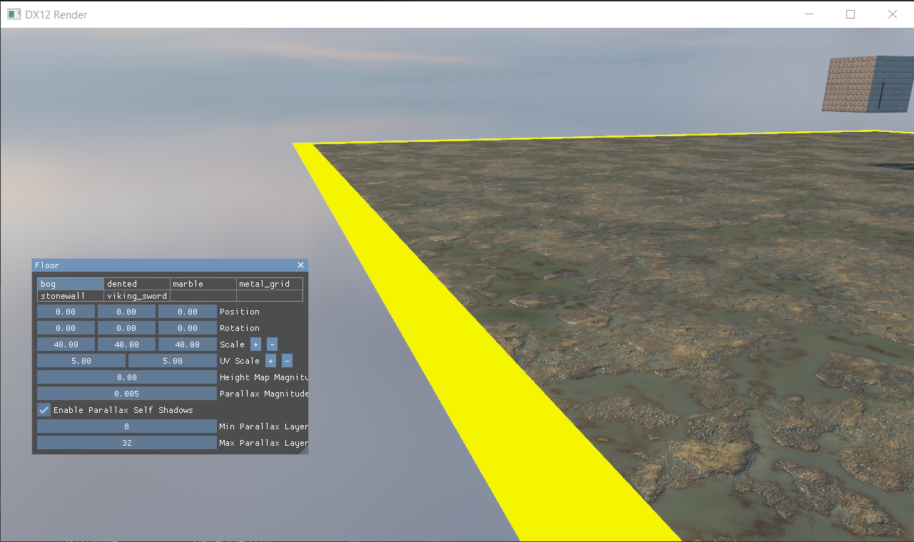
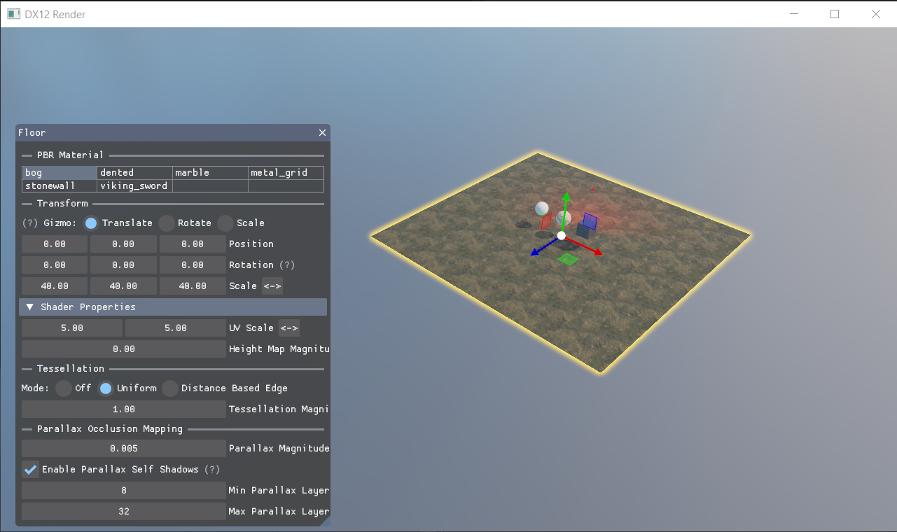
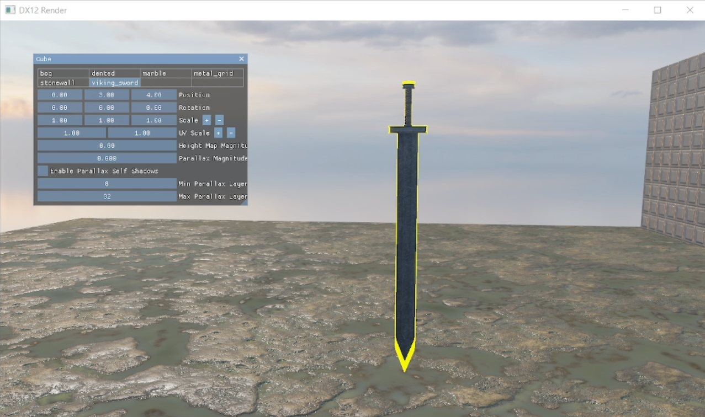
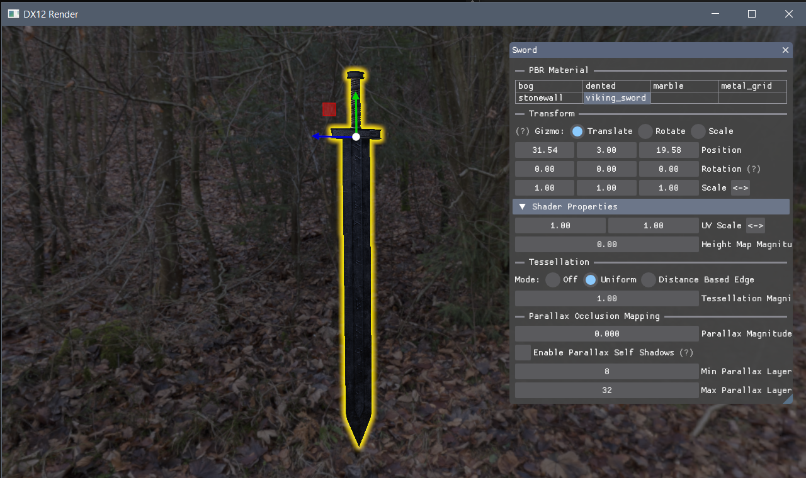
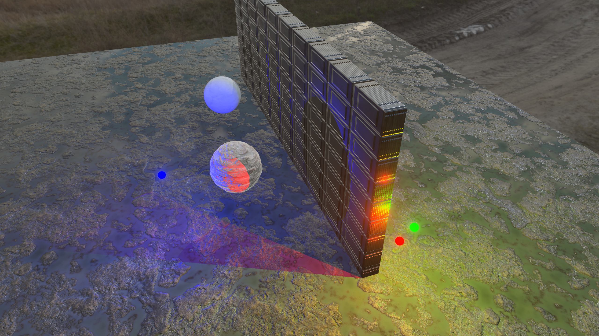
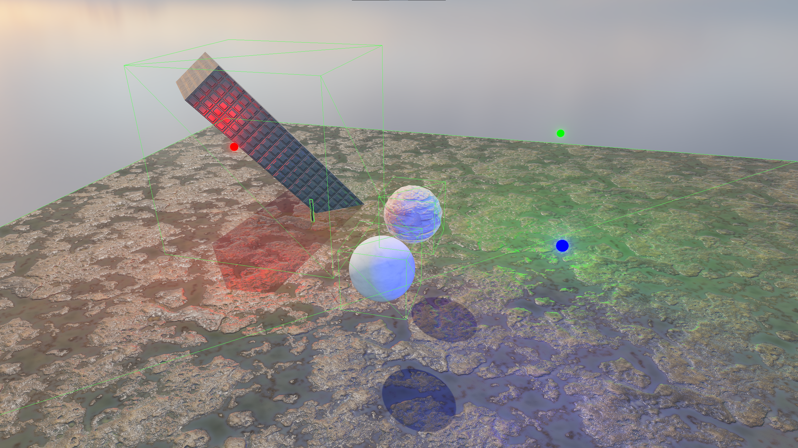

# C++ DX12 Game Engine
3D DirectX 12 engine made from scratch in C++. After familiarizing myself with Direct3D and rendering in my [DX11 Project](https://github.com/JKHYuen/DX11Engine), I started over and ported all the features to DX12 to get some experience with a modern rendering API. New features were added and old ones were completely rewritten and generally improved with modern C++. 

It was a challenging and time consuming process, but [this tutorial](https://www.3dgep.com/learning-directx-12-1/) series provided a good start. All source files that started from the tutorial have the orignial copyright notices in the headers. Major changes are documented but it is non-exhaustive, [see here](https://github.com/jpvanoosten/LearningDirectX12) for the original tutorial source. This is an ongoing project for learning rendering techniques, but I plan to eventually transition to a more robust abstraction layer like [NVRHI](https://github.com/NVIDIA-RTX/NVRHI) for a more serious project. 

***Windows 64-bit required, only tested on a NVIDIA gpu**

**NOTE: This engine renders in HDR colors with floating point color buffers, however Windows HDR mode is not currently supported. Rendering still works, but colors will not be properly tonemapped (it will look dim).**

## Feature Highlights
- HDR physically based rendering (PBR) with image-based lighting (IBL)
	- Using Epic Game's version of the Cook-Torrance BRDF developed for Unreal 4 ([link](https://cdn2.unrealengine.com/Resources/files/2013SiggraphPresentationsNotes-26915738.pdf) p. 1 - 8)
	- HDR linear space color calculations with gamma correction
	- Reinhard-Jodie tonemapping ([link](https://64.github.io/tonemapping/#reinhard-jodie))
- IBL environment maps (Irradiance and Pre-Filtered (specular) cubemap) generation from equirectangular .hdr files at runtime
	- Skybox cubemap generation and rendering
	- Skyboxes/environment maps can be loaded/switched during run time
- Bloom
	- Progressive down and up sampling with box sampling
- A novel screen space outline effect implementation that provides geometry agnostic outlining for clicked objects
    - Low resolution post-process bloom pass provides an outline effect with even thickness in screen space
    - Bloom effect also provides a useful feature where smaller objects relative to the screen will have thicker (more feathered) outlines than bigger objects
		- this method does not use depth information, so it does not provide inner outlines and does not have any of the usual depth artifacts, which are desirable features for a scene editing tool
    - This implementation solves issues with common methods like [inverse hull](https://studio.uclaacm.com/byte-sized-tutorials/unity-urp-outline-shaders), which struggles with sharp edges and certain viewing angles (see images below)
  
 Before (Inverted Hull) / After (My Implementation):
 
 

Far objects retain an even outline thickness that scales in screen space:

 

- Parallax occlusion mapping with optional self shadowing
- Directional light with shadow mapping (other types of lights delayed until switching to deferred rendering)
	- Simple 3x3 multisample PCF using HLSL compare sampling for efficient soft shadows
- Point lights with cubemap shadow mapping (same PCF method as directional light shadows)

- Object frustum culling
    - Use secondary debug camera render to see it work
- Tessellation with hull and domain shaders with two modes:
	- Basic uniform tessellation
	- Distance based edge tessellation
- UI for real time scene/material editing and debugging
	- Made with [Dear ImGui](https://github.com/ocornut/imgui), using a custom made theme
- AABB generation / visualization
	- rotations supported, displacement maps not yet supported

- MSAA (will be replaced with TAA when switching to deferred rendering)
	- defaults to x8 or highest hardware supports
    - Note: texture and specular aliasing is still prevalent without a post processing anti-aliasing solution

## Basic Controls
See in app menu (F1) for full controls.
- Click and drag to change numeric values, double click to type in values
- Cursor and movement is disabled when menus are open
- Hold **RIGHT CLICK** when menus are open to reenable camera look and movement
- **LEFT CLICK** objects with menus open to enable object inspector
- Hold **LALT** to enable cursor to click on objects without menus

		  F1: Toggle UI
	     ESC: (First press) Unlock cursor from window / (Second press) Quit app
	     F11: Toggle fullscreen
		   V: Toggle Vsync
        WASD: Camera movement
          QE: Move camera up/down
      LSHIFT: Move fast
       LCTRL: Move slow

## Caveats
This was a first attempt at a modern renderer, some important base systems like resource state tracking/transitioning and memory management are adapted from [the tutorial mentioned](https://www.3dgep.com/learning-directx-12-1/) and are not well tested. There are major features that will not be added until switching to something more robust like NVRHI:
- Render graph system
- Smarter PSO management/generation
- Bindless resources 
	
## High Priority TODOs / Research Topics
- Switch from forward rendering to deferred rendering with forward pass for transparency
- TAA
- Cascaded shadow mapping
- Light/reflection probes
- Water rendering
- Occlusion culling (HZB)
- Procedural sky shading
- Volumetrics

## Asset Sources
- https://polyhaven.com/hdris
- https://freepbr.com/

## Resources Used
 - https://github.com/ocornut/imgui
 	- https://github.com/epezent/implot
    - https://github.com/CedricGuillemet/ImGuizmo 	 
 - https://www.3dgep.com/learning-directx-12-1/ (Lessons 1 - 4)
 - https://learnopengl.com/PBR/IBL/Diffuse-irradiance
 - https://learnopengl.com/Advanced-Lighting/Parallax-Mapping
 - https://chanhaeng.blogspot.com/2019/01/normalparllax-mapping-with-self.html
 - https://catlikecoding.com/unity/tutorials/advanced-rendering/bloom/
 - https://catlikecoding.com/unity/tutorials/advanced-rendering/tessellation/
